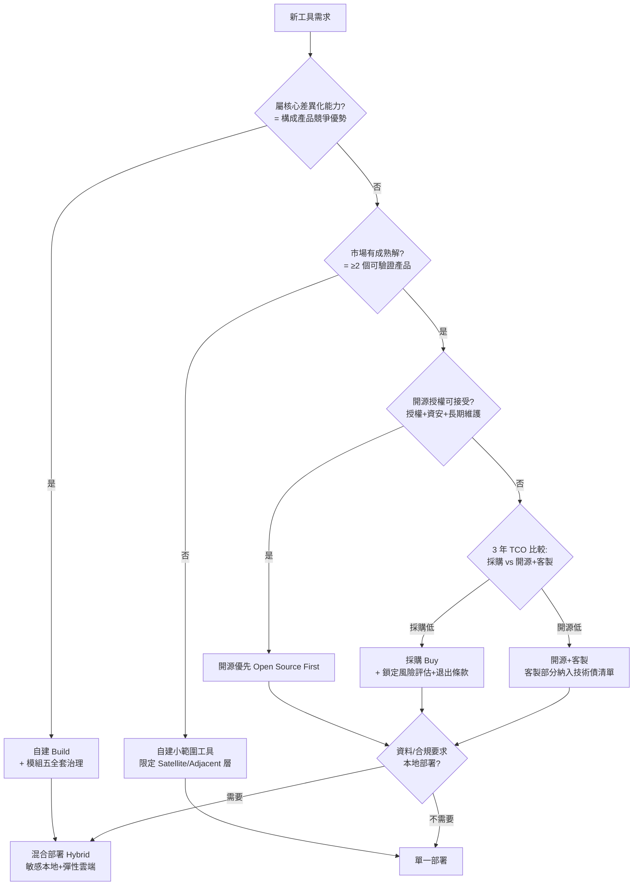
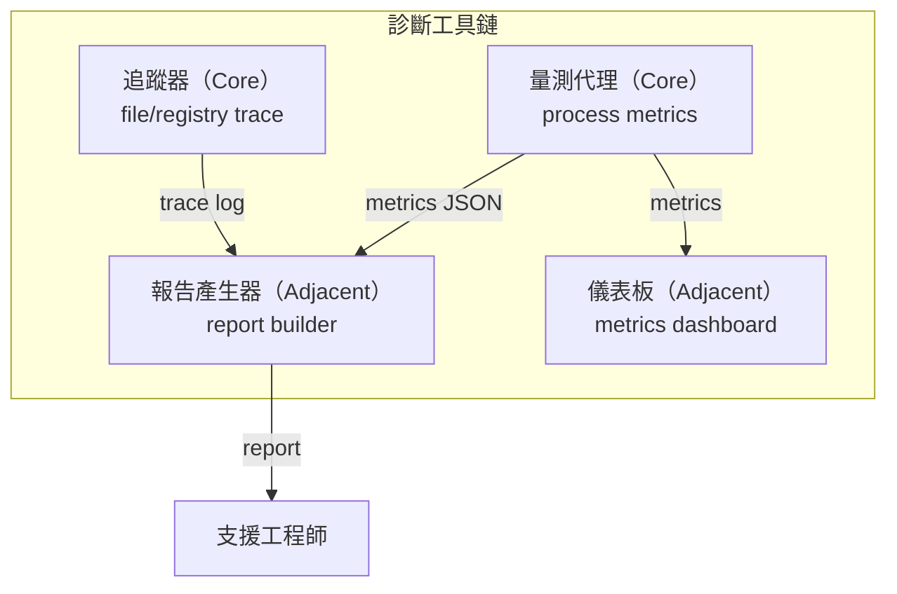

# 工具鏈評估、選擇與整合系統化方法論 v1.0
（Toolchain Evaluation, Selection & Integration Methodology）

> 版本：v1.0｜日期：2026-11-18｜狀態：Draft（待核准）
> 適用領域：軟體開發（Software Development）、資料分析（Data Analytics）、專案管理（Project Management）與一般工程工具鏈治理
> 設計原則：證據驅動（Evidence-Driven）、先量測後決策（Measure Before Decide）、可落地（Actionable）、可維護（Maintainable）
> 術語慣例：重要術語保留英文原文，首次出現附中文註釋。

---

## 0. 方法論總覽（Methodology Overview）

五大模組為**單向依賴的管線**，每個模組的產出是下一個模組的輸入；任何模組重做時，僅需向下游重跑受影響部分。

```
模組一  需求拆解與情境分級 ──► 產出：需求規格書 + 已分級情境清單
   │
   ▼
模組二  工具評估維度與計分 ──► 產出：評分矩陣 + 短名單（Shortlist）
   │
   ▼
模組三  組合策略與架構模式 ──► 產出：架構決策 + 整合設計 + 退出計畫
   │
   ▼
模組四  驗證與迭代機制     ──► 產出：POC 報告 + 指標儀表板 + 技術債清單
   │
   ▼
模組五  交付成果標準化     ──► 產出：C4 圖 + ADR + Runbook + 風險清單
```

**貫穿性紀律（適用全部模組）**

| 紀律 | 定義 | 違反後果 |
|---|---|---|
| 證據驅動（Evidence-Driven） | 每個評分、每項宣稱須附量測方法與日期；未量測標 `UNKNOWN`，且 `UNKNOWN ≠ PASS ≠ FAIL` | 評分無效，須重評 |
| 先量測後動刀（Measure Before Decide） | 動手修改前，先以機器可重現的方式量測現狀 | 決策基於猜測 |
| 單一事實來源（SSOT, Single Source of Truth） | 每項事實只在一處定義，其他位置以連結引用 | 文件漂移（drift） |
| 修訂不刪除（Revise, Don't Erase） | 被取代的內容標 `SUPERSEDED` 就地歸檔，不刪除 | 歷史軌跡遺失 |

---

## 模組一：需求拆解與情境分級框架
（Requirements Decomposition & Scenario Grading Framework）

### 1.1 四層拆解流程（Four-Layer Decomposition）

```
L1 業務目標（Business Objective）
   └─ 定義「為什麼做」：可量化的商業成果，禁止把手段當目標
L2 核心情境（Core Scenario）
   └─ 定義「誰在什麼情況下做什麼」：真實脈絡中的完整互動敘事
L3 關鍵任務（Key Task）
   └─ 定義「做什麼」：情境內可指派、可驗證的最小工作單元
L4 驗收標準（Acceptance Criteria）
   └─ 定義「做到什麼程度算完成」：Given/When/Then（BDD 格式）
```

**拆解紀律**

1. **每層可追溯**：下層必須能指回上層 ID（`OBJ-01 → SCN-03 → TSK-12 → AC-3`），出現孤兒任務即拆解失敗。
2. **L1 必須可量化**：含基準值（baseline）、目標值（target）、期限。
3. **L4 必須可機器驗證**：能轉成自動化測試或量測腳本；不能者標 `MANUAL-VERIFY` 並指定人工驗證人。
4. **垂直完整**：每個 L2 情境至少 1 條 L4；每條 L4 至少對應 1 個工具能力需求。

### 1.2 四層拆解範本（可直接複製）

```markdown
## 需求拆解書（Requirements Decomposition Sheet）

### L1 業務目標
| ID | 目標陳述 | 基準值（Baseline） | 目標值（Target） | 期限 | 負責人 |
|---|---|---|---|---|---|
| OBJ-01 | 透過標準化效能診斷，將 ERP 慢速問題平均定位時間從 X 縮短至 Y | X 小時 | Y 分鐘 | YYYY-MM-DD | 姓名 |

### L2 核心情境
| ID | 對應目標 | 情境陳述（身分＋觸發＋流程＋產出＋頻率） | 頻率 |
|---|---|---|---|
| SCN-01 | OBJ-01 | 當 ERP 反應遲鈍時，支援工程師以標準診斷流程於 15 分鐘內產出瓶頸報告 | 每週 2–5 次 |

### L3 關鍵任務
| ID | 對應情境 | 任務陳述 | 需要的工具能力 |
|---|---|---|---|
| TSK-01 | SCN-01 | 擷取高負載時段的 CPU／磁碟／網路活動 | 行程級即時監控（process-level monitoring） |
| TSK-02 | SCN-01 | 追蹤單一操作涉及的檔案與登錄存取 | 檔案／登錄追蹤（file/registry tracing） |

### L4 驗收標準
| ID | 對應任務 | Given（前置） | When（動作） | Then（結果） | 驗證方式 |
|---|---|---|---|---|---|
| AC-01 | TSK-01 | 系統處於高負載 | 執行診斷流程 | 15 分鐘內產出含 top-3 瓶頸的報告 | 計時腳本 |
| AC-02 | TSK-02 | 指定單一 ERP 操作 | 開始追蹤並重放操作 | 產出按時間排序的完整存取清單 | 人工抽查＋腳本比對 |
```

### 1.3 情境優先級矩陣（Priority Matrix：影響度 × 頻次 × 風險）

**三軸定義（各 1–5 分）**

| 軸 | 5 分 | 4 分 | 3 分 | 2 分 | 1 分 |
|---|---|---|---|---|---|
| 影響度（Impact, I） | 營運中斷／重大財損 | 核心功能受阻 | 部分使用者受阻 | 體驗下降 | 邊際影響 |
| 頻次（Frequency, F） | 每日多次 | 每日一次 | 每週數次 | 每月數次 | 每年一至數次 |
| 風險（Risk, R） | 資安／法規／資料遺失 | 資料品質風險 | 效能劣化風險 | 流程繞道風險 | 無明顯風險 |

**優先級分數與分級**

```
P = I × F × R        （範圍 1–125）
P0：P ≥ 60  →  首週必須納入工具鏈範圍（阻塞級，Blocking）
P1：30 ≤ P < 60  →  本迭代納入（重要級，Important）
P2：10 ≤ P < 30  →  路線圖規劃（規劃級，Planned）
P3：P < 10   →  觀察清單（Backlog）
```

**分級範例（以「ERP 效能診斷」為例）**

| 情境 | I | F | R | P | 級別 | 裁定 |
|---|---|---|---|---|---|---|
| 月結批次逾時，影響全公司出貨 | 5 | 2 | 4 | 40 | P1 | 本迭代 |
| 畫面查詢慢，使用者每日反覆遇到 | 4 | 5 | 2 | 40 | P1 | 本迭代 |
| 報表匯出鎖死資料庫 | 5 | 3 | 5 | 75 | P0 | 首週 |
| 年度歸檔作業緩慢 | 3 | 1 | 1 | 3 | P3 | 觀察 |

**分級紀律**：P = 三軸乘積僅為**初排序**；最終裁決須由負責人簽核，且任何升級／降級須在矩陣旁註記理由與日期（證據驅動）。

---

## 模組二：工具評估維度與計分模型
（Tool Evaluation Dimensions & Scoring Model）

### 2.1 五大維度定義（Five Dimensions）

| # | 維度 | 中文註釋 | 建議權重 | 核心問題 |
|---|---|---|---|---|
| D1 | Functional Coverage | 功能覆蓋率 | 30% | 不加外掛時，覆蓋多少已分級情境？ |
| D2 | Integration Compatibility | 整合相容性 | 25% | 能否接上現有工具鏈（API/CLI/資料格式/平台）？ |
| D3 | Learning Curve | 學習曲線 | 15% | 團隊多久能產出第一次有效成果？ |
| D4 | Licensing & TCO | 授權／擁有成本 | 15% | 三年總持有成本多少？ |
| D5 | Extensibility & Ecosystem | 擴充性與生態 | 15% | 需求超出預設時能否擴充？會否被鎖定（lock-in）？ |

**權重調整指南**：受監管產業（金融／醫療）可將 D4 提升至 20%、D3 降至 10%；研究探索型專案可將 D5 提升至 25%。權重變更須在評分前定案並記錄理由，評分中不得調整（防止湊分）。

### 2.2 各維度量化指標、評分量表（1–5）與資料來源

**D1 功能覆蓋率（30%）**
- 量化指標：`覆蓋率 = (開箱即用覆蓋的 P0+P1 情境數) ÷ (P0+P1 情境總數)`
- 量表：5＝100% P0 且 ≥80% P1｜4＝100% P0，P1 需輕度設定｜3＝≥70% P0，其餘需外掛或腳本｜2＝≥50% P0｜1＝<50% P0
- 資料來源：官方功能清單實測（以 L2 情境逐條打勾）、試用環境操作紀錄（附日期）

**D2 整合相容性（25%）**
- 量化指標：①官方 API／CLI／SDK／Webhook 有無（各 0.5 分）②標準資料格式支援（JSON／CSV／OpenAPI，各 0.5 分）③目標平台支援（OS／瀏覽器／雲，0.5 分）④與現有核心工具的官方整合數（0.5 分）→ 合計換算 1–5
- 量表：5＝全項原生支援｜3＝核心可整合、部分需中介層（glue code）｜1＝僅人工作業或格式不互通
- 資料來源：官方文件（以 context7 類官方文件來源為準，不用過期訓練記憶）、實際串接煙霧測試（smoke test）紀錄

**D3 學習曲線（15%）**
- 量化指標：TTFV（Time-to-First-Value，新人從安裝到首次成功產出的工時）、官方文件完整度（教程／API 文件／疑難排解三項有無）、社群規模（issue 活躍度、問答數量）
- 量表：5＝TTFV ≤ 2 小時且三項文件齊備｜4＝≤ 1 天｜3＝≤ 3 天｜2＝≤ 1 週｜1＝> 1 週或文件嚴重缺失
- 資料來源：安排 1 名未接觸者實測 TTFV並計時（唯一有效證據）；社群數據取自儲存庫／問答站

**D4 授權／擁有成本（15%）**
- 量化指標：三年 TCO ＝ 授權費 ＋ 基礎設施費 ＋ 維運工時成本 ＋ 遷移／培訓一次性成本
- 量表：5＝免費開源且維運近零｜4＝免費但需定期維運｜3＝低成本訂閱（人均年費低）｜2＝中高成本｜1＝高額訂閱＋需專職人力
- 資料來源：官方報價頁、授權條款全文（法務可讀）、內部工時估算（附估算方法）

**D5 擴充性與生態（15%）**
- 量化指標：①外掛／擴充 API 存在②腳本化／自動化能力③第三方外掛數量④資料可匯出性（匯出格式完整）⑤供應商路線圖透明度
- 量表：5＝全項具備且資料完全可攜｜3＝可擴充但生態小｜1＝封閉且資料不可匯出
- 資料來源：擴充文件、實際寫一個最小擴充驗證（附代碼）、社群統計

### 2.3 計分表範本（可直接複製）

```markdown
## 工具評分矩陣（Tool Scoring Matrix）
評測人：＿＿＿｜日期：＿＿＿｜權重版本：v1（30/25/15/15/15）

| 維度 | 權重 | 工具 A | 工具 B | 工具 C |
|---|---|---|---|---|
| D1 功能覆蓋率 | 30% | 4 | | |
| D2 整合相容性 | 25% | 3 | | |
| D3 學習曲線 | 15% | 5 | | |
| D4 授權／TCO | 15% | 5 | | |
| D5 擴充性生態 | 15% | 4 | | |
| **加權總分（滿分 5.0）** | | **4.10** | | |

### 證據附錄（每格分數必須能指到至少一條證據）
| 工具 | 維度 | 分數 | 證據（量測方法＋日期＋連結） |
|---|---|---|---|
| A | D1=4 | 4 | 以 SCN-01..08 實測：7/8 覆蓋（2026-11-17 實測紀錄 #123） |

### 否決權檢核（一票否決，不計分）
| 檢核項 | 工具 A | 工具 B | 工具 C |
|---|---|---|---|
| 資安／合規硬性要求 | PASS | | |
| 授權法務風險 | PASS | | |
| 不可逆鎖定（lock-in） | PASS | | |
```

**入選門檻（Thresholds）**

| 加權總分 | 裁定 |
|---|---|
| ≥ 4.0 | 直接入選（直接進入模組三組合設計） |
| 3.0 – 3.9 | 進入 POC 驗證（模組四），POC 通過才入選 |
| < 3.0 | 排除；例外條件：該 P0 情境無任何替代工具，則記錄風險並要求供應商改進計畫 |

---

## 模組三：組合策略與架構模式
（Composition Strategy & Architecture Patterns）

### 3.1 核心＋輔助分層（Core + Auxiliary Layering）

| 層 | 定義 | 整合深度 | 替換成本 | 設計要求 |
|---|---|---|---|---|
| **Core（核心層）** | 支撐 P0 情境、不可短時替換 | 深整合（資料模型級） | 高（週→月） | 必須有 ADR、退出計畫、資料匯出方案 |
| **Adjacent（日常層）** | 高頻但可替換的工作工具 | 中整合（API/CLI 級） | 中（天→週） | 介面標準化即可，避免深度耦合 |
| **Satellite（衛星層）** | 低頻診斷／臨時用途 | 淺整合（人工作業級） | 低（小時） | 只需使用說明，不寫入自動化流程 |

**分層紀律**： Satellite 工具禁止進入 CI／自動化管線（否則升級為 Adjacent 並補足相應治理）。

### 3.2 冗餘備援設計（Redundancy Design）

| 備援等級 | 適用對象 | 要求 |
|---|---|---|
| 熱備援（Hot Standby） | Core 層中斷即營運中斷者 | 第二工具常駐可用，切換演練每季一次 |
| 冷備援（Cold Standby） | Core 層可容忍數日中斷者 | 替代路徑文件化（Runbook），演練每半年一次 |
| 免備援 | Satellite 層、唯讀診斷工具 | 不適用（中斷不造成損失） |

**備援成本控制**：備援僅要求「路徑存在且演練過」，不要求雙工具並行維運。

### 3.3 介面標準化（Interface Standardization）

| 介面類型 | 標準要求 |
|---|---|
| **API** | 遵循 OpenAPI 規格；版本化（URI 或 header）；向下相容政策（deprecation 提前 ≥1 個版本公告） |
| **CLI** | 統一退出碼語意：`0`＝成功、`1`＝失敗、`2`＝使用錯誤；stdout 僅放資料、診斷訊息走 stderr；支援 `--format json` 機器可讀輸出 |
| **事件匯流排（Event Bus）** | 採用 CloudEvents 1.0 信封；至少一次交付（at-least-once）＋消費端冪等（idempotency）；死信佇列（DLQ, Dead Letter Queue）必設 |

### 3.4 決策樹：自建／採購／開源／混合（Build / Buy / Open Source / Hybrid）



**決策樹使用規則**

1. 每個分支裁定須附證據（如「市場有成熟解」須列出 ≥2 個已驗證產品）。
2. 「自建」裁定必須同時回答：**誰維護？何時棄用？** 無答案即不得自建。
3. 「採購」裁定必須附：退出條款（exit clause）、資料匯出驗證、鎖定風險（lock-in risk）評級。
4. 任何選擇的 ADR 須包含「替代方案（已否決）」節，記錄為何其他路徑落選。

---

## 模組四：驗證與迭代機制
（Validation & Iteration Mechanism）

### 4.1 POC 設計範本（Proof of Concept Template，可直接複製）

```markdown
# POC 計畫書：<工具名稱>（POC-YYYYMMDD-<編號>）

## 1. 範圍（Scope）
- **納入（In Scope）**：僅驗證 P0 情境 SCN-01、SCN-02 對應的 TSK-01..03
- **排除（Out of Scope）**：生產部署、正式資料、全員培訓
- **環境**：隔離測試環境／隔離資料副本（禁止直接使用生產資料，除非唯讀且已核准）

## 2. 成功準則（Success Criteria，全部可量化）
| # | 準則 | 目標值 | 量測方法 |
|---|---|---|---|
| S1 | 情境覆蓋 | SCN-01、SCN-02 全覆蓋 | 逐條打勾表 |
| S2 | 效能 | TSK-01 執行 ≤ 10 分鐘 | 計時腳本三次取中位數 |
| S3 | 正確性 | 與既有基準工具結果一致（差異可解釋） | 雙工具平行比對 |
| S4 | 整合 | CLI 退出碼符合 0/1/2 語意 | 煙霧測試腳本 |

## 3. 時間箱（Timebox）
- 期限：≤ 10 個工作日（超時未完成 → 視為 POC 失敗，除非延期理由獲核准一次）

## 4. 回滾條件（Rollback Conditions，任一成立即中止 POC）
- R1：引入未修補的高風險漏洞（cargo audit / 供應商公告級別）
- R2：需提升生產帳號權限才能繼續驗證
- R3：兩次中期檢查（第 3、7 日）未達當期里程碑
- R4：對既有工具鏈產生不可逆變更

## 5. 產出物（Deliverables）
- POC 報告（含 Evidence-Driven A–L 節構）：實測數據、截圖、退出碼紀錄
- 五維度計分表更新（回填模組二）
- 入選／排除建議 + 理由
```

**POC 紀律**：POC 產生的腳本與筆記**視為正式資產**入版控（不散落個人資料夾）；POC 結束後環境須還原（還原步驟寫入 POC 計畫書 §1）。

### 4.2 關鍵指標追蹤儀表板（Metrics Dashboard）

| 類別 | 指標 | 定義／公式 | 目標值（範例） | 量測頻率 | 資料來源 |
|---|---|---|---|---|---|
| 效能（Performance） | p95 延遲 | 第 95 百分位操作耗時 | ≤ 基準值 | 每日 | 量測腳本 |
| 效能 | 吞吐量 | 每分鐘完成操作數 | ≥ 基準值 | 每日 | 量測腳本 |
| 效能 | 錯誤率 | 失敗操作 ÷ 總操作 | < 1% | 每日 | 日誌彙總 |
| 成本（Cost） | 授權支出 | 當期授權費用 | ≤ 預算 | 每月 | 財務／供應商帳單 |
| 成本 | 維運工時 | 投入該工具鏈的維護小時 | ≤ 規劃值 | 每月 | 工時紀錄 |
| 採用率（Adoption） | 週活躍使用者 WAU | 每週實際使用人數 | ≥ 目標覆蓋率 | 每週 | 使用統計 |
| 採用率 | 情境覆蓋使用率 | P0+P1 情境中實際改用新鏈的比例 | ≥ 80%（3 個月內） | 每月 | 情境對照表 |
| 缺陷（Defect） | 逃逸缺陷數 | 到達使用者才被發現的缺陷 | 趨勢下降 | 每迭代 | 缺陷追蹤系統 |
| 缺陷 | MTTR | 平均修復時間（Mean Time To Repair） | ≤ 目標值 | 每迭代 | 缺陷追蹤系統 |

**儀表板紀律**：每個指標必須有「量測方法＋日期」；無法自動量測者標 `MANUAL` 並指定負責人；連續兩期未量測的指標自儀表板移除（防止殭屍指標）。

### 4.3 技術債管理（Technical Debt Management）

**識別（Identify）**：所有「明知非最佳但暫時接受」的決定，發生當下即登記，禁止事後補登。

```markdown
## 技術債登記簿（Debt Register）
| ID | 登記日 | 描述 | 產生原因 | 影響 | 觸發償還條件 | 狀態 |
|---|---|---|---|---|---|---|
| TD-01 | 2026-11-18 | 診斷腳本以 5.1 相容語法撰寫，未用 PS7 特性 | 本機僅 5.1 可用 | 效能／可讀性 | CI shell 統一為 pwsh 時 | OPEN |
```

**分級（Grade）**：以「影響 × 償還成本」二維分級——
- **P0**：影響大＋成本低 → 立即償還（下一迭代）
- **P1**：影響大＋成本高 → 排程償還（明確版本／日期）
- **P2**：影響小＋成本低 → 順手償還（touch-and-fix，接觸到即修）
- **P3**：影響小＋成本高 → 記錄接受（每季重審一次是否仍成立）

**償還排程（Repayment Schedule）**：採 **20% 容量法則**——每迭代保留 20% 工時償還 P0/P1 技術債；P2 採 touch-and-fix；連續兩迭代未消化 P0 → 升級為阻塞項目，暫停新功能。

**治理節奏（Governance Cadence）**
| 節奏 | 活動 |
|---|---|
| 每迭代 | 技術債 triage：新債登記、P0 清點 |
| 每月 | 償還進度對帳（登記簿狀態 vs 實際提交） |
| 每季 | 全量重審：P3 是否仍成立、20% 容量是否兌現、指標儀表板校準 |

---

## 模組五：交付成果標準化範本
（Deliverable Standardization Templates）

### 5.1 架構圖：C4 模型（C4 Model）

C4 四層：Context（系統情境）→ Container（容器）→ Component（元件）→ Code（代碼）。**工具鏈方案至少交付 Level 1 與 Level 2。**

**Level 1 System Context 範本（Mermaid，可直接複製）**


**Level 2 Container 範本（Mermaid，可直接複製）**



**填寫規範**：每個 Container 標註「層級（Core/Adjacent/Satellite）＋ 所對應 SCN-ID ＋ 負責人」；圖與文字說明同檔維護，圖改必同步改文字（SSOT）。

### 5.2 決策紀錄（ADR, Architecture Decision Record）

```markdown
# ADR-<編號> — <決策標題>

> 狀態：Draft｜Proposed｜Accepted｜SUPERSEDED by ADR-XXX
> 日期：YYYY-MM-DD｜決策者：＿＿｜影響範圍：＿＿

## 1. 背景（Context）
編號列點陳述事實與問題；每項事實附證據（量測／文件／實測紀錄）。

## 2. 決策（Decision）
編號列點；每點一行、可獨立執行。

## 3. 後果（Consequences）
- 正面：…
- 負面：…（必填，禁止只寫正面）
- 遵此：後續必須執行的動作

## 4. 替代方案（已否決 Alternatives Rejected）
| 方案 | 否決理由 | 證據 |
|---|---|---|

## 5. 關聯（References）
相關 ADR／情境 ID／風險清單條目
```

**填寫範例（節錄）**——以「診斷工具鏈採用成熟系統監控套件（如 Sysinternals Suite）」為例：
- 背景：①ERP 效能問題定位平均耗時 4 小時（2026-11 量測）②現有手動流程缺乏行程級與 IO 級可見性（Runbook v1.0 §3）
- 決策：①納入 Process Monitor／Process Explorer／Handle 為 Satellite 層診斷工具 ②僅診斷 session 啟用，禁止常駐生產環境 ③使用方式寫入 Runbook §診斷流程
- 後果：正面——定位時間可縮短；負面——ProcMon 全量追蹤產生大量資料，須先設過濾器；需系統管理員權限
- 替代方案（已否決）：自建 ETW 追蹤器——否決，開發成本高且非核心差異化（決策樹 D→E→F 路徑）
- 關聯：SCN-01、TSK-01/02、Runbook §診斷

### 5.3 操作手冊（Runbook）

```markdown
# Runbook：<作業名稱>（v<主>.<次>）

## 1. 前置條件（Prerequisites）
- 權限：…｜工具版本：…｜環境：…｜備份：已備份（連結）

## 2. 作業步驟（Procedure）
步驟 1：…（每步含「預期輸出」；用 `;` 串接命令、不使用 &&）
步驟 2：…

## 3. 驗證（Verification）
| 檢核項 | 預期 | 實際（填寫） | 判定 PASS/FAIL/UNKNOWN |
|---|---|---|---|

## 4. 回滾（Rollback）
還原步驟 + 還原驗證點

## 5. 升級路徑（Escalation）
條件 → 聯絡人 → 需提供的證據（錯誤訊息全文＋步驟紀錄）
```

**版本控管**：主版本 = 流程性變更（步驟增刪）；次版本 = 參數／工具版本更新；文件與代碼**同一提交**更新。

### 5.4 風險與緩解清單（Risk & Mitigation Register）

```markdown
| ID | 風險描述 | 可能性(1-5) | 衝擊(1-5) | 等級(=可能性×衝擊) | 緩解措施 | 應變措施 | 負責人 | 狀態 |
|---|---|---|---|---|---|---|---|---|
| RSK-01 | ProcMon 未設過濾器產生 GB 級資料拖慢生產機 | 4 | 4 | 16 | 僅診斷 session 啟用＋標準過濾器範本 | 立即停止擷取＋還原環境 | ＿＿ | OPEN |
| RSK-02 | 開源工具斷更 | 2 | 4 | 8 | 鎖定版本＋每季評估活躍度 | 啟用冷備援替代路徑 | ＿＿ | OPEN |
```

**等級門檻**：≥ 12 為高風險（須負責人簽核緩解計畫）；8–11 中（列入季審）；< 8 低（觀察）。

### 5.5 版本控管規範（Version Control Norms，全交付物適用）

| 規範 | 內容 |
|---|---|
| 語意化版本（SemVer） | 文件比照軟體：MAJOR＝結構性重構／流程變更；MINOR＝新增節或參數更新；PATCH＝勘誤 |
| 單一事實來源（SSOT） | 每項事實只在一處；他處以「檔案＋節號」連結引用 |
| 同一提交 | 文件與其描述的代碼／腳本**同一提交**變更（防止版本漂移） |
| 修訂不刪除 | 被取代條文標 `SUPERSEDED` 就地保留；歷史編號不得重用 |
| 術語一致 | 英文術語首次出現附中文註釋，之後可用原文 |
| 狀態標記 | 每份文件標頭必含：版本／日期／狀態（Draft／Active／SUPERSEDED） |

---

## 快速啟動檢查清單（First-Week Quick-Start Checklist）

```markdown
## 首週落地檢查清單（每日可勾選；全項須附證據連結）

### Day 1 — 定錨（Why）
- [ ] 召集利益相關人（stakeholders），確認 1–3 條 L1 業務目標（含基準值／目標值／期限）
- [ ] 指定方法論負責人（methodology owner）與各模組負責人
- [ ] 建立文件目錄與版本控管位置（git repo + 路徑約定）

### Day 2 — 拆解（What）
- [ ] 完成四層拆解：每個 L1 ≥ 2 條 L2 情境；每條 L2 ≥ 1 條 L4 驗收標準
- [ ] 以影響度 × 頻次 × 風險完成情境分級（P0–P3），裁定紀錄留檔
- [ ] 檢查無孤兒任務（每條 L3/L4 可指回上層 ID）

### Day 3 — 計分（Which）
- [ ] 長名單（long list）：每個 P0/P1 情境 ≥ 3 個候選工具
- [ ] 定案權重（含調整理由），並宣告「評分期間權重凍結」
- [ ] 完成否決權檢核（資安／法務／鎖定）→ 淘汰不合格者
- [ ] 完成五維度初評 → 產出短名單（shortlist，≤ 3 個）

### Day 4 — 組合與驗證設計（How）
- [ ] 對短名單完成自建／採購／開源／混合決策樹走查（每分支附證據）
- [ ] 產出 Core/Adjacent/Satellite 分層草案與備援等級
- [ ] 為 3.0–3.9 分工具撰寫 POC 計畫書（範圍／成功準則／時間箱／回滾條件）

### Day 5 — 啟動與儀表化（Run & Measure）
- [ ] POC 啟動（環境隔離、基線量測已完成並留存）
- [ ] 建立指標儀表板骨架（四類指標各 ≥ 1 項，含量測方法）
- [ ] 建立技術債登記簿與風險清單（各 ≥ 1 條真實條目）
- [ ] 排定治理節奏（每迭代 triage／每月對帳／每季重審）並發出第一次會議邀請

### 首週完成判定（Gate）
- [ ] 全部勾選項附證據連結；無證據者標 UNKNOWN 並列入 Day 8 補測
- [ ] 產出物齊備：需求拆解書、評分矩陣、分層草案、POC 計畫書、儀表板、債簿、風險清單
```

---

## 附錄 A：模組產出物總表（Deliverables Matrix）

| 模組 | 產出物 | 必要性 | 版控位置建議 |
|---|---|---|---|
| 一 | 需求拆解書（含分級矩陣） | 必要 | `docs/toolchain/requirements.md` |
| 二 | 評分矩陣＋證據附錄 | 必要 | `docs/toolchain/scoring.md` |
| 三 | 分層設計＋決策樹走查紀錄 | 必要 | `docs/toolchain/composition.md` |
| 四 | POC 報告／指標儀表板／技術債登記簿 | 必要 | `docs/toolchain/validation.md`、`debt-register.md` |
| 五 | C4 圖／ADR／Runbook／風險清單 | 必要 | `docs/adr/`、`docs/04-operations/`、`docs/toolchain/risks.md` |

## 附錄 B：反模式（Anti-Patterns，出現即停止並回退到對應模組）

| 反模式 | 症狀 | 回退動作 |
|---|---|---|
| 工具先鋒（Tool First） | 先選工具再找需求 | 回模組一重拆解 |
| 湊分評比 | 評分期間調權重使偏好工具勝出 | 作廢評分，凍結權重重評 |
| 試用變生產 | POC 環境直接轉正式，未走驗收 | 回模組四補驗收 |
| 孤兒自動化 | Satellite 工具寫進 CI 無治理 | 升級層級並補 ADR 或移除 |
| 殭屍指標 | 儀表板指標連續兩期未量測 | 移除或指定量測負責人 |
| 無退出採購 | 採購未附資料匯出與退出條款 | 回模組三補退出計畫 |
