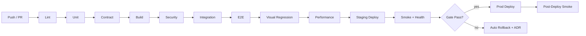
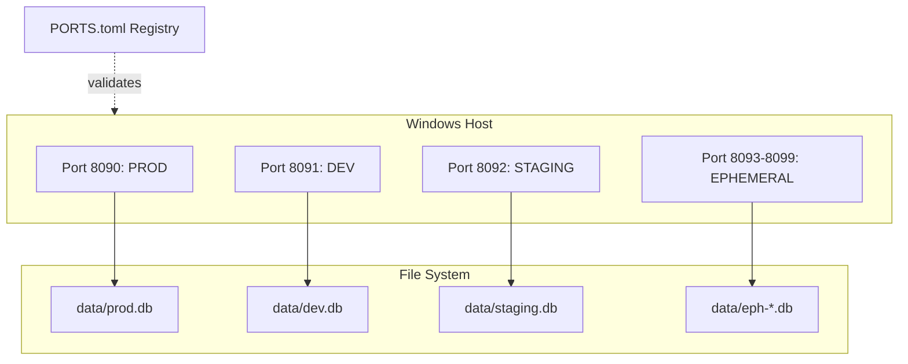
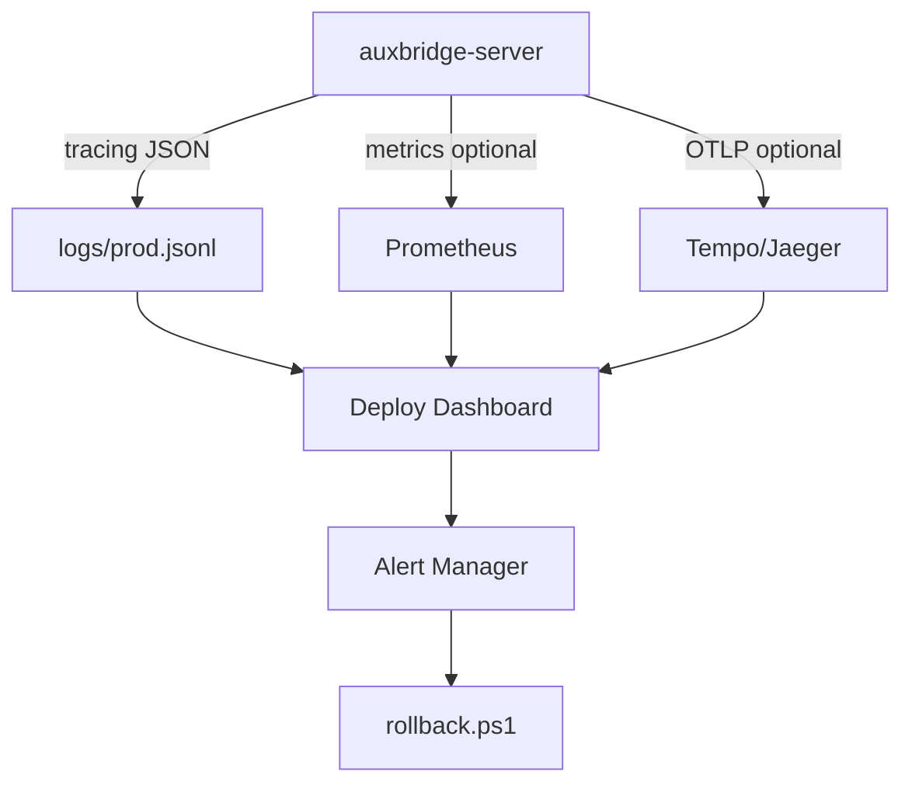

# CI/CD 架構與版本控制策略
> 2026-11-17 Reviewed（整合完成計畫 1794810000000 I-4）：掃描無未勾選任務（\- [ ]\=0）；無未關閉程式任務。證據：PLAN_REGISTER addendum #52。

> 狀態：Implementation-ready / 待審核｜版本：v1.4（修訂：三項未驗證假設）｜日期：2026-11-17
> 適用：`Dev/` 根 workspace（core/platform/web/crates/*）＋`platform-hub`（獨立 workspace）；`ekpi-platform` 與 `Wellfit` 各依其 AGENTS.md 獨立操作
> Owner：platform-team｜關聯：ADR-0001、ADR-0014、SHARED_STANDARDS、corrections C-01..C-13

## 0. 範圍與右 sizing

單機 Windows 單體（Axum 0.7 + SQLite + Tauri 2.0），無微服務/多節點。**不引入** K8s / Service Mesh / Argo CD / Consul / Vault（成本遠超收益，違反 C-13）。所有企業級能力以漸進式架構落地：先檔案/腳本層，再服務層。升級觸發：服務數 ≥ 5、跨機部署、RTO < 5 分鐘、需要灰度流量分割。Canary 在 Phase 2 前以「post-deploy smoke + health check」取代。

## 1. 現況痛點 → 對應

| # | 痛點 | 對應 |
|---|---|---|
| 1 | 版本隔離缺失、埠號搶佔（8090/8095/8096 並存） | §3、§4、§17.0 |
| 2 | 規格倒退、無品質門禁 | §5、§6 |
| 3 | 介面隨意變更 | §7 |
| 4 | 無可追溯性 | §8、§9、§10 |

## 2. Git 分支與版本策略

- **分支**：Trunk-Based + Worktree。`main` 受保護（PR + 門禁全綠）；Agent 平行流走 `.git/worktrees/`。
- **版本**：SemVer（目前 0.2.0）；Tag `v0.2.0`；`git-cliff` 自動 CHANGELOG。
- **Monorepo**：根 workspace 單一 repo（github.com/it-wellfit/dev.git）；`platform-hub` 同 repo 不同 workspace（CI 用 `working-directory`）；`ekpi-platform`/`Wellfit` 獨立 repo。
- **Commit**：`<type>: <subject>`；PR 必關聯 Issue/ADR。

## 3. 環境隔離

### 3.1 環境對應表

| 環境 | 埠 | 資料庫 | 用途 | 部署觸發 |
|---|---|---|---|---|
| prod | 8090 | `data/prod.db` | 對外展示與日常使用 | tag push + 人工 approval |
| dev | 8091 | `data/dev.db`（空＋種子） | 開發者/AI 日常驗證 | PR open / push |
| staging | 8092 | `data/staging.db`（匿名化快照） | 整合測試、視覺回歸基線 | merge to main |
| ephemeral | 8093-8099 | `data/eph-<id>.db` | Agent worktree 隔離 | Agent Manager 啟動 |

### 3.2 隔離機制

1. DB 檔案隔離：每環境獨立 SQLite 檔；`AUXBRIDGE_DB_URL` 強制指定。
2. 埠號隔離：§4。
3. 程序隔離：獨立 process；PID 檔 `run/<env>.pid`。
4. 環境變數隔離：`.env.<env>`（gitignore）；CI 注入 secrets。

### 3.3 流水線拓撲



### 3.4 環境隔離與流量路由



### 3.5 資料種子與快照

- **dev**：`sqlx::migrate!` 後執行 `scripts/seed-dev.sql`（固定測試帳號 + 5 筆樣本交易）；冪等。
- **staging**：由 prod 匿名化快照產生（`tools/anonymize-db`）；每週更新。
- **ephemeral**：複製 `data/dev.db.template` 到 `data/eph-<id>.db`。

## 4. 埠號管理與服務發現

### 4.1 埠號登記表 SSOT：`docs/ops/PORTS.toml`

```toml
[[service]]
name = "auxbridge-prod"; port = 8090; env = "prod"; owner = "platform-team"; health = "/health"
[[service]]
name = "auxbridge-dev"; port = 8091; env = "dev"; owner = "platform-team"; health = "/health"
[[service]]
name = "auxbridge-staging"; port = 8092; env = "staging"; owner = "platform-team"; health = "/health"
[[service]]
name = "auxbridge-ephemeral"; port_range = "8093-8099"; env = "ephemeral"; owner = "agent-manager"; health = "/health"
```

### 4.2 衝突檢測：`tools/port-check.ps1`

```powershell
param([string]$Registry = "docs/ops/PORTS.toml", [int]$Port)
$ErrorActionPreference = "Stop"
$registered = (Select-String -Path $Registry -Pattern 'port\s*=\s*(\d+)' | ForEach-Object { [int]$_.Matches.Groups[1].Value })
if ($Port) { $registered = @($Port) }
$listening = (Get-NetTCPConnection -State Listen | Select-Object -ExpandProperty LocalPort -Unique)
$conflict = $registered | Where-Object { $_ -in $listening }
if ($conflict) { Write-Error "Port conflict: $($conflict -join ', ')"; exit 1 }
Write-Host "OK: $($registered.Count) ports free"
```

### 4.3 服務發現（漸進式）

- Phase 1：`PORTS.toml` + 啟動腳本讀取。
- Phase 2（觸發條件 §0）：Consul/etcd + health check。

### 4.3.1 Ephemeral 埠號配置（決策：方案 A — 固定範圍 8093-8099）

Agent Manager 啟動時讀取 `run/ephemeral.lock`（JSON：`{port, pid, started_at, worktree_path}`）；釋放時刪除。超過 7 個並行 worktree → fail-fast。升級觸發：並行 worktree 經常 > 5 個 → 改方案 B（動態掃描 + 鎖檔）。

### 4.4 健康檢查端點（Phase 0 任務，目前不存在）

```json
{"status":"ok","version":"0.2.0","commit":"abc1234","uptime_s":123,"db_ok":true}
```

#### 4.4.1 實作骨架（`platform/src/api.rs`）

```rust
pub async fn health(State(state): State<AppState>) -> Json<HealthResponse> {
    let db_ok = sqlx::query("SELECT 1").execute(&state.pool).await.is_ok();
    Json(HealthResponse {
        status: if db_ok { "ok" } else { "degraded" },
        version: env!("CARGO_PKG_VERSION"),
        commit: env!("BUILD_COMMIT"),
        build_time: env!("BUILD_TIME"),
        uptime_s: state.started_at.elapsed().as_secs(),
        db_ok,
    })
}
// router: .route("/health", get(health)).route("/ready", get(ready))
```

#### 4.4.2 build.rs（`platform/build.rs`，新檔）

```rust
use std::process::Command;
fn main() {
    let commit = Command::new("git").args(["rev-parse", "--short", "HEAD"])
        .output().ok().and_then(|o| String::from_utf8(o.stdout).ok())
        .unwrap_or_else(|| "unknown".into()).trim().to_string();
    let time = chrono::Utc::now().to_rfc3339();
    println!("cargo:rustc-env=BUILD_COMMIT={commit}");
    println!("cargo:rustc-env=BUILD_TIME={time}");
    println!("cargo:rerun-if-changed=../.git/HEAD");
}
```

`AppState` 需新增 `started_at: Instant`。

## 5. 品質門禁

### 5.1 門禁矩陣（每次 PR 必過）

| 階段 | 工具 | 門檻 | 失敗處理 |
|---|---|---|---|
| Lint | `cargo fmt --check` + `cargo clippy --all-targets -- -D warnings` | 零警告 | 阻擋合併 |
| Unit | `cargo test --locked` | 0 failed / 0 ignored | 阻擋合併 |
| Contract | insta snapshot + JSON Schema | 零 diff 未審核 | 阻擋合併 |
| Build | `cargo build --release` | 成功 | 阻擋合併 |
| Security | `cargo audit` + `cargo deny check` | 零高危 | 阻擋合併 |
| Integration | `platform/tests/*` | 0 failed | 阻擋合併 |
| E2E | Playwright MCP（Rust browser-mcp） | 0 failed | 阻擋合併 |
| Visual Regression | `tools/visual-diff`（Rust image crate） | 像素差 < 0.5% | 阻擋合併 |
| Performance | `cargo bench` + stress test | p95 不可倒退 > 5% | 阻擋合併（可申請豁免） |
| Migration | `sqlx migrate` dry-run | 成功 | 阻擋合併 |

### 5.2 基線不可倒退原則

- 效能基線：`docs/benchmarks/baseline.json`。
- 視覺基線：`tests/visual/baseline/`。
- 契約基線：`tests/contracts/`。
- PR 需更新基線時，附 ADR 說明「為何新值優於舊值」，reviewer 簽核。

### 5.3 `--locked` 鎖檔漂移注意

平行流新增 workspace member 會修改 `Cargo.lock`。CI 用 `--locked`；開發者本地用 `cargo test`（無 `--locked`），提交前必須同步 lock 變更並在 PR 中說明。

## 6. 契約測試

- **SSOT**：`console_manifest`（`NAV_GROUPS` + `PAGES`）。
- **Snapshot**：`insta`（Rust，零 Node）。
- **Schema**：API JSON 輸出以 `jsonschema` crate 驗證。
- **拒絕**：Python `schemathesis`（違反 Rust-first C-11）。

```rust
// platform/tests/contract_nav.rs
#[test]
fn nav_manifest_snapshot() {
    let flags = NavFlags { /* admin */ ..Default::default() };
    let model = NavModel::build(&flags, "/bankpay");
    let rendered = render_nav(&model);
    insta::assert_snapshot!("nav_bankpay_admin", rendered);
}
```

## 7. 設計系統與視覺回歸

### 7.1 設計系統 SSOT

- `web/assets/design-system.css`（Token）＋ `web/assets/ui-v2.css`（佈局）。
- Token 變更必須附 before/after 截圖 + 你（設計簽核）核可。
- 禁止內聯硬編碼（SHARED_STANDARDS）。

### 7.2 視覺回歸工具鏈

- 截圖：Playwright MCP（Rust `browser-mcp`，零 Node）。
- 比對：`tools/visual-diff`（Rust `image` crate）。
- 閾值：像素差 < 0.5%。

### 7.3 視覺回歸腳本：`tools/visual-diff/src/main.rs`

```rust
// 輸入：baseline.png candidate.png --threshold 0.005
// 輸出：diff.png + 退出碼（0=pass, 1=fail, 2=error）
use image::GenericImageView;
fn main() {
    let args: Vec<String> = std::env::args().collect();
    let base = image::open(&args[1]).unwrap();
    let cand = image::open(&args[2]).unwrap();
    assert_eq!(base.dimensions(), cand.dimensions(), "dimension mismatch");
    let (w, h) = base.dimensions();
    let mut diff_pixels = 0u64;
    let total = (w * h) as u64;
    for y in 0..h { for x in 0..w {
        if base.get_pixel(x, y) != cand.get_pixel(x, y) { diff_pixels += 1; }
    } }
    let ratio = diff_pixels as f64 / total as f64;
    let threshold: f64 = args[4].parse().unwrap_or(0.005);
    println!("diff_ratio={:.4} threshold={:.4} pixels={}/{}", ratio, threshold, diff_pixels, total);
    if ratio > threshold { std::process::exit(1); }
}
```

### 7.4 UI 變更管控流程

1. PR 修改 `*.css` 或 `templates/*.html` → 自動觸發 Visual Regression。
2. 基線更新需 reviewer + 你（設計簽核）核可。
3. 破壞性變更阻擋合併，除非 ADR 說明。

## 8. 全鏈路可觀測性

### 8.1 三大支柱（Rust-native / OSS）

| 支柱 | 工具 | 儲存 |
|---|---|---|
| Logs | `tracing` + `tracing-subscriber`（JSON） | `logs/<env>.jsonl`；可選 Loki |
| Metrics | `metrics` + `metrics-exporter-prometheus` | Prometheus（可選） |
| Traces | `tracing-opentelemetry` + OTLP | Jaeger/Tempo（可選） |

**注意**（2026-11-17 實作時事實修正）：`tracing` 依賴不存在是**刻意決策**——`platform/src/obs.rs` 以 std＋chrono 實現零依賴結構化日誌（原 tracing facade 無 subscriber → 日誌蒸發；模組文檔論證「淨精實」）。任務改為：obs.rs 增 `AUXBRIDGE_LOG_FORMAT=json` 輸出 `logs/<env>.jsonl`（預設人類可讀不變）。

### 8.2 部署追蹤

- 每次 deploy 寫入 `docs/ops/DEPLOY_LOG.md`：時間、commit SHA、tag、環境、operator、結果。
- 二進位嵌入 `BUILD_INFO` 於 `/health`（需 build.rs，目前無）。
- Git Tag 與 Release 自動關聯。

### 8.3 告警

- 健康檢查失敗 → 自動回滾 + 通知。
- 錯誤率超閾值（錯誤預算 §10.1）→ 告警。
- 效能 p95 倒退 > 5% → 告警。

## 9. 回滾與災難恢復

### 9.1 回滾觸發條件（自動）

| 觸發 | 閾值 | 動作 |
|---|---|---|
| `/health` 連續失敗 | 3 次（間隔 10s） | 自動回滾 + 告警 |
| `/ready` 失敗 | 1 次 | 阻擋流量切換 |
| 錯誤率（5xx） | > 5% 持續 2 分鐘 | 自動回滾 |
| p95 延遲 | > 基線 200% 持續 5 分鐘 | 告警（人工決定） |
| DB 連線失敗 | 1 次 | 立即回滾 |

### 9.2 回滾機制

- **藍綠部署**：新舊二進位並存；舊版保留 7 天。
- **一鍵回滾**：`tools/rollback.ps1`（參數 `-TargetTag` `-Env` `-Port`）：

```powershell
param([string]$TargetTag, [int]$Port = 8090, [string]$Env = "prod")
$ErrorActionPreference = "Stop"
$binDir = "$env:LOCALAPPDATA\Flaps ERP"
$backup = "$binDir\backup\$TargetTag"
if (-not (Test-Path $backup)) { throw "backup not found: $backup" }
Get-NetTCPConnection -LocalPort $Port -State Listen -ErrorAction SilentlyContinue |
  ForEach-Object { Stop-Process -Id $_.OwningProcess -Force }
Start-Sleep -Milliseconds 800
Copy-Item "$backup\flaps-server.exe" "$binDir\flaps-server.exe" -Force
Copy-Item "$backup\*.db" "data\" -Force
& "$binDir\flaps-server.exe"
Write-Host "Rolled back to $TargetTag on port $Port"
```

- **DB 遷移回滾**：每個 migration 必附 `down.sql`；`sqlx migrate revert`；SQLite 額外檔案層備份（`auxbridge-backup` binary）。

### 9.2.1 部署腳本：`tools/deploy.ps1`

```powershell
param([ValidateSet("dev","staging","prod")][string]$Env = "dev", [string]$Tag = "")
$ErrorActionPreference = "Stop"
$port = @{dev=8091;staging=8092;prod=8090}[$Env]
$binDir = "$env:LOCALAPPDATA\Flaps ERP"
$exe = "$binDir\flaps-server.exe"
& "$PSScriptRoot\port-check.ps1" -Port $port
$backupDir = "$binDir\backup\pre-deploy-$(Get-Date -Format yyyyMMddHHmmss)"
New-Item -ItemType Directory -Force -Path $backupDir | Out-Null
Copy-Item $exe "$backupDir\" -Force -ErrorAction SilentlyContinue
Copy-Item "data\$Env.db" "$backupDir\" -Force -ErrorAction SilentlyContinue
Get-NetTCPConnection -LocalPort $port -State Listen -ErrorAction SilentlyContinue |
  ForEach-Object { Stop-Process -Id $_.OwningProcess -Force }
Start-Sleep -Milliseconds 800
Copy-Item "$binDir\incoming\flaps-server.exe" $exe -Force
$env:AUXBRIDGE_PORT = $port
$env:AUXBRIDGE_DB_URL = "sqlite://$PWD/data/$Env.db?mode=rwc"
Start-Process -FilePath $exe -WindowStyle Hidden
$ok = $false
for ($i = 0; $i -lt 30 -and -not $ok; $i++) {
    Start-Sleep -Seconds 1
    try { $r = Invoke-WebRequest -Uri "http://127.0.0.1:$port/health" -UseBasicParsing -TimeoutSec 2
          if ($r.StatusCode -eq 200) { $ok = $true } } catch {}
}
if (-not $ok) {
    Write-Error "Health check failed; rolling back"
    & "$PSScriptRoot\rollback.ps1" -TargetTag "pre-deploy" -Port $port
    exit 1
}
Write-Host "Deployed to $Env on port $port (tag=$Tag)"
```

### 9.3 RTO/RPO

| 指標 | 目標 |
|---|---|
| RTO | ≤ 5 分鐘（二進位 + DB 還原） |
| RPO | 0（SQLite 檔案複製 + 備份） |

### 9.4 演練

- 季度回滾演練 → `docs/ops/DRILL_LOG.md`。
- 通過條件：RTO ≤ 5 分鐘、資料完整性 100%。

## 10. 持續改進機制

### 10.1 錯誤預算（SLO 待定 — UNKNOWN）

- 原訂「99.5%（月度）／錯誤預算 ≈ 216 分鐘/月」為未經驗證之假設值，**已刪除**（C-10：UNKNOWN ≠ PASS）。
- SLO 改由**實際使用模式反推**，待補三項輸入：①部署頻率（每月發布次數 → 維護停機預算）②可接受停機時長（單次事故最長容忍）③用戶影響範圍（單機內部工具 / 對外服務）。
- 補齊後計算式：`SLO = 1 −（可接受停機分鐘/月 ÷ 月總分鐘數）`；`錯誤預算 = 1 − SLO`。
- 機制不變：預算耗盡 → 凍結功能發布，專注修復。

### 10.2 ADR 自動生成：`tools/adr-new.ps1`

```powershell
param([string]$Title)
$ErrorActionPreference = "Stop"
$date = Get-Date -Format "yyyy-MM-dd"
$slug = ($Title -replace "[^\w\s-]", "" -replace "\s+", "-").ToLower()
$n = (Get-ChildItem "docs/adr" -Filter "ADR-*.md").Count + 1
$path = "docs/adr/ADR-{0:D4}-{1}.md" -f $n, $slug
@"
# ADR-$($n.ToString("D4")): $Title
> 日期：$date ｜狀態：Proposed ｜決策者：
## 背景
## 決策
## 替代方案比較
## 風險評估
## 預期收益
## 驗證方式
## 後果
"@ | Set-Content -Path $path -Encoding UTF8
Write-Host "Created $path"
```

### 10.3 事故後複盤模板：`docs/ops/POSTMORTEM_TEMPLATE.md`

```markdown
# 事故複盤：<標題>
日期 / 嚴重程度 / 影響時長 / 影響範圍
## 時間線（UTC+8）
## 根因
## 偵測延遲（MTTD）/ 恢復時間（MTTR）
## 緩解措施
## 預防措施（含 Owner + 期限）
## 關聯 ADR
```

### 10.4 版本演進評分卡（每版必填）

| 維度 | 前版 | 本版 | 證據連結 |
|---|---|---|---|
| 功能完整性 | | | |
| 效能（p95） | | | |
| 安全（audit 高危數） | | | |
| 可維護性（clippy 警告數） | | | |
| 使用者體驗（視覺回歸通過率） | | | |
| **總評** | **單調遞增** | | |

任何維度倒退必須在 ADR 中量化說明並 reviewer 簽核。

## 11. GitHub Actions Pipeline

```yaml
name: CI
on:
  push: { branches: [main] }
  pull_request: { branches: [main] }
  push: { tags: ['v*'] }

env: { CARGO_TERM_COLOR: always, RUST_BACKTRACE: 1 }

jobs:
  lint:
    runs-on: windows-latest
    steps:
      - uses: actions/checkout@v4
      - uses: dtolnay/rust-toolchain@stable
        with: { components: rustfmt, clippy }
      - run: cargo fmt -- --check
      - run: cargo clippy --all-targets -- -D warnings

  unit:
    runs-on: windows-latest
    needs: lint
    steps:
      - uses: actions/checkout@v4
      - uses: dtolnay/rust-toolchain@stable
      - run: cargo test --locked

  contract:
    runs-on: windows-latest
    needs: unit
    steps:
      - uses: actions/checkout@v4
      - uses: dtolnay/rust-toolchain@stable
      - run: cargo test --locked -p platform --test 'contract_*'

  build:
    runs-on: windows-latest
    needs: contract
    steps:
      - uses: actions/checkout@v4
      - uses: dtolnay/rust-toolchain@stable
      - run: cargo build --release --locked
      - uses: actions/upload-artifact@v4
        with: { name: auxbridge-server, path: target/release/auxbridge-server.exe }

  security:
    runs-on: windows-latest
    needs: build
    steps:
      - uses: actions/checkout@v4
      - uses: dtolnay/rust-toolchain@stable
      - run: cargo install cargo-audit cargo-deny
      - run: cargo audit
      - run: cargo deny check

  integration:
    runs-on: windows-latest
    needs: security
    steps:
      - uses: actions/checkout@v4
      - uses: dtolnay/rust-toolchain@stable
      - run: cargo test --locked -p platform

  visual-regression:
    runs-on: windows-latest
    needs: integration
    steps:
      - uses: actions/checkout@v4
      - uses: dtolnay/rust-toolchain@stable
      - run: cargo run -p visual-diff -- tests/visual/baseline tests/visual/candidate --threshold 0.005

  performance:
    runs-on: windows-latest
    needs: visual-regression
    steps:
      - uses: actions/checkout@v4
      - uses: dtolnay/rust-toolchain@stable
      - run: cargo bench --locked
      - run: cargo test --locked -p platform stress_10000

  staging-deploy:
    runs-on: windows-latest
    needs: performance
    if: github.ref == 'refs/heads/main'
    steps:
      - uses: actions/download-artifact@v4
        with: { name: auxbridge-server }
      - run: .\tools\deploy.ps1 -Env staging

  prod-deploy:
    runs-on: windows-latest
    needs: staging-deploy
    if: startsWith(github.ref, 'refs/tags/v')
    environment: production
    steps:
      - uses: actions/download-artifact@v4
        with: { name: auxbridge-server }
      - run: .\tools\deploy.ps1 -Env prod -Tag ${{ github.ref_name }}
```

**注意**：`platform-hub` 為獨立 workspace，需在 CI 中加 `working-directory: platform-hub` 的 parallel job；`ekpi-platform` 為獨立 repo，CI 獨立。

### 11.1 成本試算與免費額度守門

> 下表分鐘數為**上線前估算（UNKNOWN）**，首次 CI 實跑後以實測值校正（C-10）。

**單次完整 pipeline 分鐘數（Windows runner，估算）**

| Job | 估算分鐘 | 備註 |
|---|---|---|
| lint | 8–12 | 冷快取 clippy 為大宗 |
| unit | 10–15 | 167+ tests |
| contract | 5–8 | |
| build（release，LTO＋codegen-units=1） | 20–30 | 本 repo 實測單機約 10-15 分，GH runner 較慢 |
| security | 10–15 | `cargo install cargo-audit cargo-deny` 為編譯安裝，極慢 → 應改 prebuilt／cache |
| integration | 10–15 | |
| visual-regression | 5 | |
| performance | 15–20 | bench＋stress |
| **合計** | **≈ 85–135 分鐘** | |

**免費額度與守門**

- 免費額度：2000 分鐘/月 × 0.5 倍率 = **1000 分鐘有效額度**（Windows runner 2× 計費之等價表示）。
- 每月預估次數：PR 15–25 次＋main push 5–10 次 ≈ **20–35 次/月**；若每次跑全鏈 ≈ 1700–4700 分鐘 → **必然超額 1.7–4.7×**。
- **守門步驟（自動，加入 CI 首個 job）**：以 GitHub API 統計當月已用分鐘數 →
  - < 80%（< 800 分鐘）：正常全鏈。
  - ≥ 80%：降級為快路徑（僅 lint＋unit＋contract；security／visual／performance 停用並標記 `SKIPPED_BUDGET`）。
  - ≥ 100%：僅 lint＋unit（改 ubuntu runner，1× 倍率，容量加倍）＋通知你決定（付費 / 自架 runner）。
- **緩解措施**：①PR 快路徑（全鏈僅 merge to main 與 tag 跑）②`Swatinem/rust-cache` 依賴快照（省 30–50% 編譯）③cargo-audit/deny 改 prebuilt binary ④Phase 2 選項：dev 機自架 self-hosted runner（免費、用本地硬體）。
- C-11 備註：Actions runner 端之 Node 屬 GitHub 平台基礎設施，非專案工件，不違反零 Node 工具鏈約束。

## 12. 工具鏈選型

| 類別 | 選型 | 理由 | 替代 | 成本 | 學習曲線 |
|---|---|---|---|---|---|
| 版控 | Git + GitHub | 已在用、免費、worktree | GitLab | 免費 | 低 |
| CI/CD | GitHub Actions | repo 整合、Windows runner 原生 | GitLab CI | 免費 tier | 低 |
| 容器 | 無（原生二進位） | 單機 Windows | Docker（可選） | 免費 | 中 |
| 服務發現 | PORTS.toml 檔案 registry | 零依賴、可審核 | Consul | 免費 | 低 |
| 契約測試 | insta + jsonschema | Rust-native、零 Node | Pact | 免費 | 低 |
| 視覺回歸 | Playwright MCP + image crate | 已有、零 Node | Chromatic（需 Node，禁用） | 免費 | 中 |
| 效能 | criterion + stress test | Rust 原生 | k6（需 Node/Go） | 免費 | 低 |
| 可觀測 | tracing + JSON logs | Rust 原生 | Grafana stack | 免費 | 中 |
| 秘密管理 | GitHub Secrets + `.env.<env>` | 簡單、足夠 | Vault | 免費 | 低 |
| ADR | Markdown + adr-new.ps1 | 零依賴 | — | 免費 | 低 |

## 13. 服務發現與埠號管理架構

```mermaid
flowchart LR
  REG[PORTS.toml SSOT] --> CHECK[port-check.ps1]
  CHECK --> CI[GitHub Actions]
  CHECK --> LOCAL[Local Dev]
  CI --> DEPLOY[deploy.ps1]
  DEPLOY --> PROC[Process Manager]
  PROC --> HEALTH[/health endpoint]
  HEALTH --> ROLLBACK[rollback.ps1]
```

## 14. 可觀測性資料流向



## 15. 責任制（RACI 兩層制：AI 代理執行、你當責）

實況＝一人＋多 AI 代理；原六角色（平台 Owner／DevOps／QA／設計 Owner／Release Manager／On-call）為未驗證假設，**已替換**為兩層制。

| 層 | 角色 | 職責 |
|---|---|---|
| 執行層 | AI 代理（code） | 實作、測試、腳本、修復門禁失敗 |
| 執行層 | AI 代理（debug） | 門禁誤報／間歇性失敗之根因調查 |
| 執行層 | AI 代理（architect） | 設計、門禁規則變更提案、ADR 草稿 |
| 當責層 | 你（唯一簽核人） | 門禁豁免簽核、基線更新簽核、tag 發布、事故回滾決策、On-call |

門禁 Owner 對應（§5.1）：Lint／Unit／Contract／Build／Security／Integration／Migration／Performance → **code**；E2E／Visual Regression → **code**（誤報根因調查 → debug）；門禁規則與基線變更提案 → **architect**。Approver 永遠是你；On-call = 你。§17.1 責任人欄位已同步對應；§7.1／§7.4 之「設計 Owner 簽核」由你行使。

## 16. 失敗模式分析（FMEA）

| 元件 | 失敗模式 | 影響半徑 | 緩解 |
|---|---|---|---|
| DB 檔案鎖定 | 無法寫入 | 單環境 | WAL 模式 + 重試 |
| 埠號衝突 | 服務無法啟動 | 單環境 | port-check.ps1 + registry |
| Migration 失敗 | 服務無法啟動 | 單環境 | down.sql + 檔案備份 |
| 視覺回歸誤報 | 阻擋合併 | PR | 閾值調整 + 人工 review |
| 效能基線漂移 | 誤報倒退 | PR | 重跑 3 次取中位數 |
| 回滾失敗 | 生產中斷 | 全站 | 保留 7 天舊版 + 季度演練 |
| `/health` 不存在 | CI deploy 驗證無法執行 | 全站 | Phase 0 任務：新增端點（實作發現：`/api/health` 已存在，改為升級＋別名） |
| ~~`tracing` 未導入~~ | ~~無結構化日誌~~ | — | **事實修正（2026-11-17 實作時發現）**：`platform/src/obs.rs` 已以零依賴方案（std+chrono）實現結構化日誌並**刻意移除** tracing（facade 無 subscriber 日誌蒸發，淨精實）；任務改為 obs.rs 增 JSON 格式（env 控制、預設不變） |

## 17. 團隊落地執行檢查清單

### 17.0 Phase 0 止血命令（立即執行）

```powershell
# 1. 退役 8095/8096 殭屍 process
Get-NetTCPConnection -LocalPort 8095,8096 -State Listen -ErrorAction SilentlyContinue |
  ForEach-Object { Stop-Process -Id $_.OwningProcess -Force }
# 2. 統一正式版為 8090（空閒時啟動）
$env:AUXBRIDGE_PORT="8090"; $env:AUXBRIDGE_DB_URL="sqlite://$PWD/data/prod.db?mode=rwc"
# 3. 驗證埠號無衝突
.\tools\port-check.ps1
# 4. 驗證 /health（Phase 0 任務完成後）
Invoke-WebRequest -Uri "http://127.0.0.1:8090/health" -UseBasicParsing
```

### 17.1 Phase 0-6 任務表

| Phase | 任務 | 責任人 | 完成定義 |
|---|---|---|---|
| **Phase 0（止血）** | 埠號 registry + port-check.ps1 | architect | `docs/ops/PORTS.toml` 入庫、CI 通過 |
| **Phase 0** | 新增 `/health` + `/ready` 端點（含 BUILD_INFO） | code | curl 回傳 commit SHA |
| **Phase 0** | 加入 `tracing` + JSON 日誌 + build.rs | code | `logs/dev.jsonl` 產生 |
| **Phase 0** | 退役 8095/8096，統一 8090(prod)/8091(dev)/8092(staging) | architect | 埠號表無衝突 |
| **Phase 0** | 重建安裝版 NSIS exe（目前 11/10 舊版） | code | exe mtime = 今日 |
| **Phase 0** | 現況盤點：埠號/DB/process 清單 | architect | `docs/ops/INVENTORY.md` |
| **Phase 0** | 基線測試快照 | code | 基線報告存檔 |
| **Phase 1** | `.github/workflows/ci.yml` 上線 | code | PR 觸發 pipeline 跑通 |
| **Phase 1** | 保護 main + required checks | code（簽核：你） | 設定截圖 |
| **Phase 1** | `platform-hub` CI parallel job | code | 兩 workspace 皆綠 |
| **Phase 2** | 環境隔離：dev/staging/prod db + 埠 | architect | 三環境並行啟動 |
| **Phase 2** | `deploy.ps1` + `rollback.ps1` | code | 演練成功 |
| **Phase 3** | insta 契約測試導入（≥ 10 snapshot） | code | 測試綠 |
| **Phase 3** | Visual Regression 基線 PNG 入庫 | code | 基線檔案存在 |
| **Phase 3** | Performance 基線 `baseline.json` | code | 檔案入庫 |
| **Phase 3** | 建立 `tools/visual-diff` crate | code | `cargo run -p visual-diff` 可執行 |
| **Phase 4** | 設計系統元件庫文件 | architect | `docs/design/` 完整 |
| **Phase 4** | PR 設計審核清單 | architect（簽核：你） | `.github/PULL_REQUEST_TEMPLATE.md` |
| **Phase 5** | 回滾演練（季度） | code + 你 | RTO ≤ 5min 證據 |
| **Phase 6** | 錯誤預算制度 | 你 | 月度報告 |
| **Phase 6** | ADR 文化固化 | code + 你 | 每 PR 附 ADR 或 N/A 說明 |
| **Phase 6** | 版本評分卡 | code + 你 | 每版必填 |

## 18. 適用場景與前提條件

- **適用**：Windows 單機 Rust monorepo、零 Node 依賴、SQLite 資料庫。
- **不適用**：多節點分散式、需要灰度流量分割、RTO < 1 分鐘。
- **升級觸發**：見 §0。
- **前提**：GitHub repo 已存在（github.com/it-wellfit/dev.git）、Rust toolchain 1.99+、PowerShell 5.1+。

## 附錄 A：命名空間约定

- 服務名：`auxbridge-<env>`（prod/dev/staging）。
- DB 檔：`data/<env>.db`。
- PID 檔：`run/<env>.pid`。
- 日誌：`logs/<env>.jsonl`。

## 附錄 B：參考

- ADR-0001 技術棧基線
- ADR-0014 供應鏈政策
- SHARED_STANDARDS §1.1（工程基線）
- corrections.md C-01..C-13（強制規則）
- plan `1793782615513-ui-v2-sidebar-redesign.md`（UI 規範）
