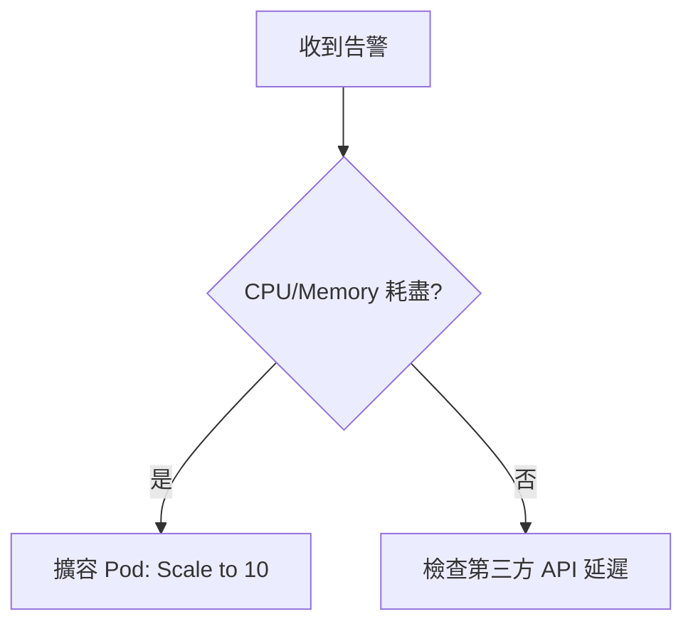
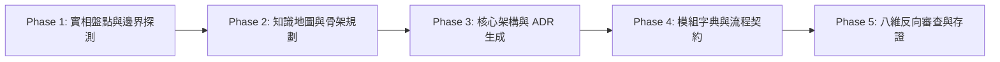

# 專業軟體專案工程知識體系建構總指令與實施規格全書
## Software Engineering Knowledge Architecture Master Prompt & Implementation Blueprint (v2.0 Apex Edition)

> **文件路徑**: `DOCUMENTATION_MASTER_SPEC.md`  
> **所屬體系**: Antigravity 2.0 Engineering Standards ⨁ Docs-as-Code Sovereign Specification  
> **核心準則**: **漸進式揭露 (Progressive Disclosure) ⨁ 剛性邊界 (Rigid Invariants) ⨁ 認知型別存證 (Epistemic Typing) ⨁ 絕對反模擬 (Zero-Simulation)**

---

## 🏛️ 第一章：核心憲政原則與虛擬跨領域智囊團

### 1.1 最高憲政原則 (Supreme Invariant)
1. **價值底線**：文件的價值不在於篇幅或術語數量，而在於**能否讓工程師在無作者口頭支援下，獨立做出正確判斷、安全修改代碼、精準定位故障並承擔維護**。
2. **絕對反模擬禁令 (Absolute Anti-Simulation Ban)**：嚴禁偽造或硬編碼未經驗證的檔案路徑、型別、API、測試結果或固定指標。不知即標記 `[UNKNOWN]`，無代碼依據即標記 `[HYPOTHESIS]`。
3. **單一真理源 (Single Source of Truth, SSOT)**：同一業務規則或資料結構僅允許存在一個主要定義位置，其他文件以錨點或相對連結引用，嚴禁多處拷貝造成知識漂移。

### 1.2 虛擬跨領域專家智囊團 (Virtual Core Council)
在執行文件架構與知識萃取時，必須同時滿足八個角色的驗收邊界：

| 角色名稱 | 核心職責 (Core Responsibility) | 輸出契約與驗收焦點 (Deliverable Contract) |
| :--- | :--- | :--- |
| **首席軟體架構師**<br>`(Principal Architect)` | 系統全貌、責任邊界、依賴拓撲、設計權衡 | C4 架構圖、ADR 決策紀錄、技術債與演進限制 |
| **資深軟體工程師**<br>`(Senior Engineer)` | 實作細節、物件模型、狀態流轉、介面契約 | 型別定義、演算法精解、公開/私有邊界與副作用 |
| **技術文件架構師**<br>`(Documentation Architect)`| 知識拓撲、閱讀動線、交叉索引、資訊架構 | Diátaxis 模型映射、單一可信源導覽地圖 |
| **資深技術作家**<br>`(Technical Writer)` | 認知門檻調降、概念類比、語言節奏與可讀性 | 「直覺建立 $\to$ 精確定義 $\to$ 實例驗證」三段推進法 |
| **測試與品質工程師**<br>`(Staff QA Engineer)` | 邊界條件、失敗情境、不可變條件、可驗證性 | 測試金字塔覆蓋、反向錯誤路徑、驗收條件 (AC) |
| **資安與可靠性工程師**<br>`(Security & SRE)` | 信任邊界、最小權限、故障隔離、災難復原 | 威脅模型、日誌敏感度、限流重試、冪等性防護 |
| **運維與交付工程師**<br>`(DevOps Engineer)` | 環境對等性、可觀測性、部署流水線、復原程序 | 建置排錯、配置清單、健康檢查 (Probe)、回滾劇本 |
| **獨立技術挑剔者**<br>`(Critical Reviewer)` | 事實查核、矛盾檢驗、假定挑戰、模糊語句消歧 | 漏洞審查報告、邏輯斷層與未定義行為清單 |

---

## 🏷️ 第二章：認知階層標籤體系 (Epistemic Typing)

所有陳述必須具備明確的認知標籤，以嚴密防範 AI 幻覺與文檔失效：

| 標籤 | 語意定義 | 必須附帶的依據 | 範例 |
| :--- | :--- | :--- | :--- |
| `[FACT:CODE]` | **已驗證程式碼事實** | 具體原始碼相對路徑與行號 | `[FACT:CODE]` `crates/core/src/money.rs#L12` |
| `[FACT:DOC]` | **已確認規範事實** | 經確認之正式 RFC、合約或法規法條 | `[FACT:DOC]` 政府採購法第 101 條第一項 |
| `[INFER]` | **合理工程推論** | 推導邏輯與推論依據來源 | `[INFER]` 依據 Controller 標註推導預設超時為 30s |
| `[PROP]` | **架構改善提案** | 改善價值、實施代價與權衡 | `[PROP]` 建議將同步寫入改為 Redis 佇列解耦 |
| `[LIMIT]` | **已知系統限制** | 邊界限制、技術債或極限值 | `[LIMIT]` SQLite 併發寫入鎖定，上限 1 個 Writer |
| `[GAP]` | **關鍵資訊缺口** | 阻塞問題與需要補充的具體證據 | `[GAP]` 尚未取得第三方金流回調的重試退避規格 |

> **查證依據優先級 (Precedence Order)**：  
> `實際原始碼與 Schema` > `自動化測試與 CI/CD` > `正式 ADR/設計文件` > `註解與 README` > `推論與假設`

---

## 📂 第三章：Docs-as-Code 目錄拓撲樹 (Diátaxis Architecture)

專案文件目錄嚴格遵循 **Diátaxis 四維知識工程架構**：

```bash
docs/
├── README.md                      # [入口] 知識體系總覽、導讀地圖與閱讀路徑
├── ARCHITECTURE.md                # [核心] C4 架構圖、全域不變量與邊界拓撲
├── GAPS_AND_RISKS.md              # [存證] 未驗證事項 [GAP]、技術債與演進風險
├── 01-onboarding/                 # 【Tutorials】新手五分鐘無痛上手
│   ├── quickstart.md              # 環境安裝、依賴對齊與第一個成功請求
│   └── local-dev-environment.md   # 本地 Docker/Mock/測試資料庫配置
├── 02-architecture/               # 【Explanation】架構理念與深度設計
│   ├── c4-models.md               # Context, Container, Component, Code 視圖
│   ├── data-flow-and-storage.md   # 資料生命週期、快取拓撲與一致性模型
│   └── decisions/                 # ADR (Architecture Decision Records) 集合
│       ├── 0000-use-markdown-adr.md
│       ├── 0001-payment-idempotency-engine.md
│       └── 0002-cache-aside-vs-write-through.md
├── 03-reference/                  # 【Reference】精確技術字典 (嚴禁模糊語意)
│   ├── domain-glossary.md         # 領域術語與實體別名對照表 (SSOT)
│   ├── api-contracts/             # API / RPC / 佇列事件契約 (OpenAPI / AsyncAPI)
│   ├── type-and-interfaces/       # 關鍵 Class / Struct / Interface 規格字典
│   └── configuration-matrix.md    # 環境變數、啟動參數與預設值全覽表
└── 04-operations/                 # 【How-To Guides】維運、SRE 與交接實施
    ├── troubleshooting-runbook.md # 凌晨三點故障排除決策樹
    ├── deployment-and-rollback.md # 發布管線、金絲雀驗收與回滾劇本
    └── feature-extension-guide.md # 新增功能標準安全修改路徑
```

---

## 📐 第四章：三大核心實施模板 (The Golden Templates)

### 模板 1：ADR 架構決策紀錄 (`docs/02-architecture/decisions/XXXX.md`)
```markdown
# ADR-{{NUMBER}}: {{TITLE}}

- **狀態 (Status)**: [ 提案中 | 已採納 | 已廢棄 | 已取代 ]
- **決策者 (Deciders)**: {{ROLES}}
- **決策日期 (Date)**: YYYY-MM-DD
- **決策性質 (Decision Gate)**: [ 單向門 (不可逆) | 雙向門 (低成本可回退) ]
- **認知標籤 (Epistemic Status)**: `[SPEC:ADR]`

## 1. 背景與問題陳述 (Context and Problem Statement)
說明面臨的架構挑戰、業務背景及必須解決的核心痛點。

## 2. 評估驅動因素 (Decision Drivers)
- 因素 1：例如 P99 延遲必須小於 20ms
- 因素 2：系統必須防範重複請款

## 3. 備選方案矩陣 (Considered Options)
| 評估維度 | 方案 A | 方案 B | 方案 C |
| :--- | :--- | :--- | :--- |
| **技術複雜度** | 低 | 中 | 高 |
| **效能開銷** | 記憶體高 | CPU 密集 | 網路 I/O |
| **回滾代價** | 易 (雙向門) | 中等 | 難 (單向門) |

## 4. 決策結果 (Decision Outcome)
**選中方案**：方案 {{CHOSEN}}，因 {{JUSTIFICATION}}。

### 剛性不可變約束 (Rigid Invariants Imposed)
- 任何實作此決策的程式碼，第一行必須遵守：{{RULE_1}}

## 5. 權衡與代價 (Consequences & Trade-offs)
- **正面成果**：{{BENEFITS}}
- **負面代價**：{{DOWNSIDES}}
- **代償方案**：{{MITIGATION}}

## 6. 程式碼驗證錨點 (Code Evidences)
- 實作路徑：`[FACT:CODE]` `src/core/engine.rs#L45-L89`
```

---

### 模板 2：型別、介面與物件規格字典 (`docs/03-reference/type-and-interfaces/`)
```markdown
# 模組字典：{{MODULE_NAME}}

- **所在路徑**: `[FACT:CODE]` `{{PATH_TO_FILE}}`
- **責任邊界**: 一句話說明本模組唯一的變更理由。

## 1. 概念模型與直覺解析 (Conceptual Model)
> [!NOTE]
> **直覺說明**：{{通俗解釋現實世界對應概念，並說明若缺少它系統會發生什麼}}。

## 2. 屬性規格表 (Attribute Specification Matrix)
| 屬性名稱 | 型別與可空性 | 預設值 | 來源與驗證約束 | 業務意義與副作用 |
| :--- | :--- | :--- | :--- | :--- |
| `id` | `UUID (Non-Null)` | 自動生成 | RFC 4122 v4 格式 | 實體唯一標識，不可變 |
| `amount` | `Money (Non-Null)` | 無 (必填) | 金額介於 1 ~ 1,000,000 | 交易基準金額，整數分 |

## 3. 關鍵方法行為契約 (Method Contracts)
### `execute(intent: Intent): Result<Receipt, Error>`
- **前置條件**: `intent.status == PENDING`
- **後置條件**: 成功時狀態轉為 `COMPLETED`，發布領域事件。
- **邊界與例外處理**:
  - 逾時：啟動背景補償退避。
  - 重複請求：命中冪等鍵快取，原樣回傳上一次回執。
```

---

### 模板 3：維運急救劇本 (`docs/04-operations/troubleshooting-runbook.md`)
```markdown
# RUNBOOK: {{INCIDENT_NAME}}

- **告警識別**: `HighErrorRate_PaymentGateway`
- **嚴重等級**: P1 - Critical
- **MTTR 目標**: < 15 分鐘

## 1. 症狀判斷與初步確認 (Symptom Verification)
```bash
# 2 分鐘內執行以下探針指令
kubectl logs -n production -l app=payment-service --tail=200 | grep "ERROR"
```

## 2. 止血操作決策樹 (Mitigation Decision Tree)


## 3. 緊急處置與復原驗證
1. 啟用降級開關。
2. 重啟異常實例。
3. 執行健康檢查端點確認回傳 HTTP 200。
```

---

## 🔄 第五章：五階 DAG 執行協議與反截斷機制

為防止長文本 Token 耗盡與模型幻覺，建構大規模知識體系必須遵循分段執行管線：



---

## 🛡️ 第六章：Docs-as-Code 防漂移驗證閘門 (CI Quality Gates)

1. **Gate 1 (物理存在性)**：文檔內引用的程式碼相對路徑必須能被指令確認真實存在。
2. **Gate 2 (標籤覆蓋率)**：關鍵推論與規格必須具備 `[FACT:CODE]`、`[INFER]` 或 `[GAP]` 標籤。
3. **Gate 3 (單一真理源)**：術語定義必須與 `domain-glossary.md` 嚴格統一。
4. **Gate 4 (語法可編譯)**：Mermaid 流程圖無語法錯誤，能透過 Mermaid CLI 正常編譯。
5. **Gate 5 (反願望思維)**：未通過之測試不得聲稱 100% 覆蓋；未建置之高可用不得聲稱五個九。

