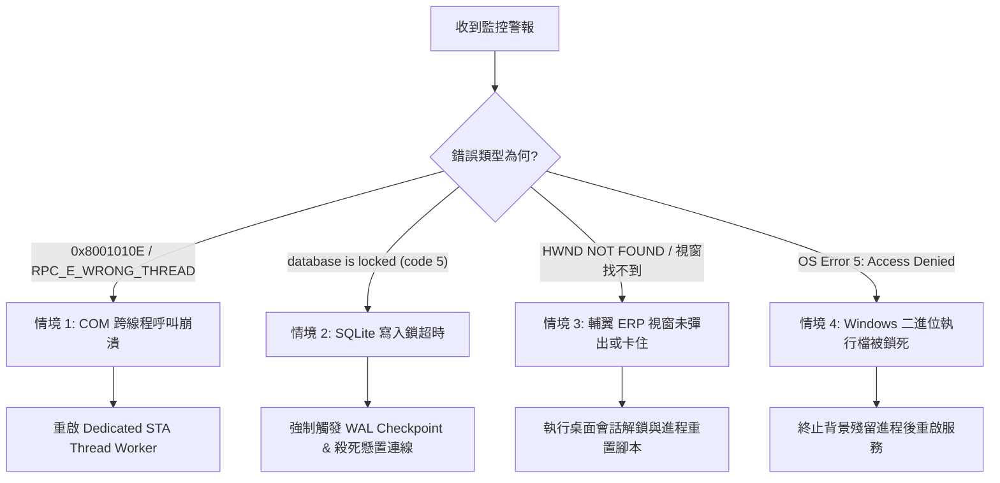

# 凌晨三點 SRE 故障排除與維運急救劇本
## Troubleshooting Runbook & Incident Mitigation Protocol

> **文件路徑**: `docs/04-operations/troubleshooting-runbook.md`  
> **適用情境**: 生產環境告警、自動化批次失敗、桌面鎖死或資料庫鎖定  
> **目標 MTTR**: $\le 15$ 分鐘 | **認知標籤**: `[FACT:DOC]`

---

## 🚨 1. 核心急救決策樹 (Mitigation Decision Tree)



---

## 🛠️ 2. 四大核心故障急救 SOP

### 情境 1：Windows COM STA 跨線程呼叫崩潰 (`RPC_E_WRONG_THREAD`)
* **症狀**：Log 出現 `0x8001010E`，RPA 批次任務瞬間 panic。
* **根因**：Tokio 協程直接持獲了 COM 指針並在不同的 Worker Thread 間跳轉。
* **止血操作**：
  1. 檢查專屬 STA 線程健康狀態。
  2. 透過微服務管理端點重置 COM Worker：
     ```powershell
     curl.exe -X POST http://127.0.0.1:8080/api/v1/admin/workers/sta-com/restart
     ```
  3. 驗證日誌：確認出現 `Dedicated STA Thread Initialized with COINIT_APARTMENTTHREADED`。

### 情境 2：SQLite 寫入鎖超時 (`database is locked`)
* **症狀**：Axum API 回傳 HTTP 500，錯誤訊息帶有 `SqliteFailure(5, "database is locked")`。
* **根因**：長時間運行的報表批次作業佔用 Write Lock 超過 5000ms。
* **止血操作**：
  1. 查詢當前鎖定狀態並執行強制 WAL Checkpoint：
     ```powershell
     sqlite3.exe data/flaps_erp.db "PRAGMA wal_checkpoint(TRUNCATE);"
     ```
  2. 若無效，優雅重啟 Platform 服務以釋放池化連線：
     ```powershell
     Stop-Process -Name "platform" -Force
     ```

### 情境 3：輔翼 ERP 視窗找不到焦點 (`HWND_NOT_FOUND`)
* **症狀**：RPA 探針報錯 `Failed to acquire Foreground Window for Class 'TFlapsMainForm'`。
* **止血操作**：
  1. 檢查目前 Windows 使用者工作階段是否處於螢幕保護或鎖定狀態：
     ```powershell
     query user
     ```
  2. 若輔翼 ERP 進程假死（Not Responding），強制清除殘留進程：
     ```powershell
     Stop-Process -Name "FlapsERP" -ErrorAction SilentlyContinue
     ```
  3. 觸發自動重新拉起與登入腳本。

### 情境 4：Windows 二進位檔案鎖定 (`OS Error 5: Access is denied`)
* **症狀**：在部署或重新編譯時，編譯器回報無法覆蓋 `.exe`。
* **止血操作**：
  ```powershell
  # 查詢並殺死殘留的平台進程
  Get-Process -Name "platform", "flaps_erp", "tauri" -ErrorAction SilentlyContinue | Stop-Process -Force
  ```

