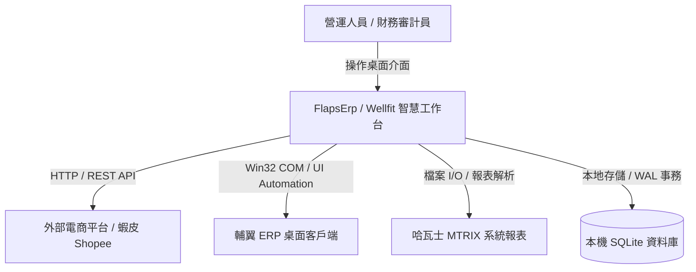
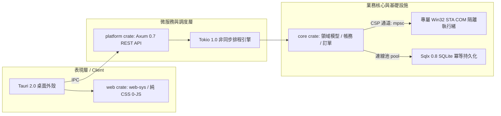
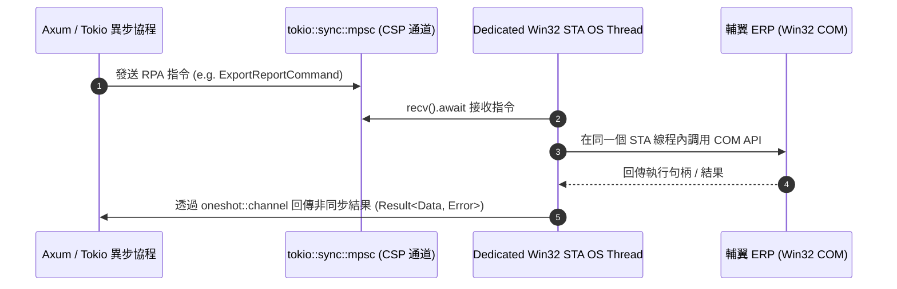

# FlapsErp / Wellfit 系統架構總綱與設計理念
## System Architecture Specification & Engineering Invariants

> **文件路徑**: `docs/ARCHITECTURE.md`  
> **所屬體系**: Antigravity 2.0 Sovereign Architecture  
> **認知標籤**: `[FACT:CODE]` ⨁ `[SPEC:ADR]`

---

## 🏛️ 1. C4 架構視圖模型 (The C4 Architectural Model)

### 1.1 Level 1: 系統情境圖 (System Context)

### 1.2 Level 2: 容器圖 (Container Diagram - Rust Workspace)
依據根目錄 `Cargo.toml` `[FACT:CODE]`，系統由三大微內核 Member 組成：

---

## ⚙️ 2. 第一性原理核心設計：Windows COM 與 Tokio STA 隔離架構

### 2.1 物理阻抗問題 (Physical Impedance Problem)
- **Tokio 特性**：採用工作竊取（Work-Stealing）調度模型，任務在非同步 `await` 之後會切換至不同 OS 線程執行。
- **Windows COM 特性**：輔翼 ERP 相關 Win32 COM 元件初始化於特定單執行緒套間（Single-Threaded Apartment, STA）。若在非原始線程呼叫 COM 物件，Windows 核心強制拋出 `0x8001010E (RPC_E_WRONG_THREAD)`。
- **解決方案 `[SPEC:ADR]`**：**CSP (Communicating Sequential Processes) 執行緒隔離模式**。

---

## 🛡️ 3. 系統剛性不變量 (Rigid Architectural Invariants)

1. **INV-01 (零浮點數貨幣計算)**：  
   `[FACT:CODE]` 所有金額計算一律採用整數分（`i64` 或封裝的 `Money` 型別），禁止在業務邏輯與資料庫中出現二進位浮點數（`f32`/`f64`），避免產生會計累積誤差。
2. **INV-02 (COM 物件專屬線程親和性)**：  
   嚴禁在 Tokio 協程池中直接持獲 COM 物件指針。所有 COM 操作必須經由 Dedicated STA Thread 封裝調用。
3. **INV-03 (SQLite 寫入事務超時保護)**：  
   `[FACT:CODE]` SQLite 連線池啟用 WAL 模式，單次寫入事務持有鎖時間嚴格限制 $\le 50\text{ms}$，並設定 `busy_timeout = 5000ms`，杜絕 `database is locked`。
4. **INV-04 (全鏈路冪等性印記)**：  
   所有蝦皮、MTRIX 與輔翼的外部寫入操作，必須在發起前於本地 SQLite 生成唯一 UUID 印記。重複觸發時僅回傳快取結果，絕不重送。

